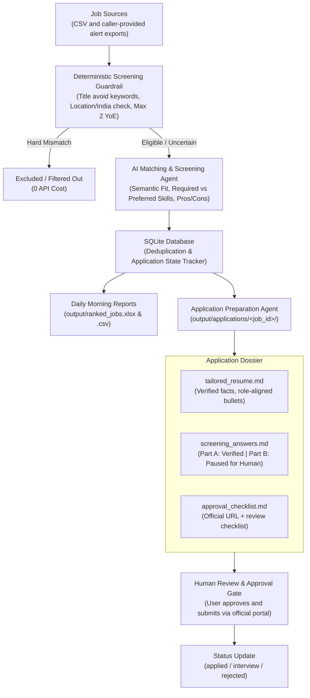

# Job Scout

A local, configurable, human-gated job discovery and application preparation assistant.

This repository is an open-source package. It imports jobs from CSV files and
caller-provided alert text, filters and ranks them against a candidate profile,
generates application drafts, and tracks application status.

> [!IMPORTANT]
> **Core Principle: Human Approval Gate Before Submission**
> This system is designed so that an LLM **never** independently invents screening answers or submits applications without your explicit review.
>
> - **Factual screening questions** (notice period, visa status, work authorization, tech stack) are drafted strictly from your verified profile.
> - **Subjective or unconfirmed questions** (motivation, custom CTC expectations) **pause** for your input.
> - **Official submission** is always performed manually by you on the employer's official website.

---

## 1. Architecture



---

## 2. Quick Start

### Step 1: Set up Virtual Environment
Open PowerShell in this directory:
```powershell
py -m venv .venv
.\.venv\Scripts\python.exe -m pip install -e .
```

### Step 2: Configure Your Profile and Preferences
1. **Preferences**: Edit `config.json` to customize your target titles, skills, and guardrails.
2. **Profile & Facts**: Edit `candidate_profile.json` with your accurate education, contact links, and verified screening facts.
3. **Optional API Key**: If you want deep LLM semantic matching, copy `.env.example` to `.env` and add your `OPENAI_API_KEY` or `GEMINI_API_KEY`. (If omitted, the agent runs in high-speed heuristic evaluation mode with 0 API cost).

### Step 3: Run the Daily Workflow
Double-click `daily_job_scout.bat` or run:
```powershell
.\.venv\Scripts\python.exe -m job_scout.cli daily
```

This single command will:
1. Ingest new jobs from `jobs.csv`.
2. Reject hard mismatches via the deterministic guardrail.
3. Score technical alignment against required and preferred skills.
4. Prepare tailored application dossiers for top matches.
5. Generate `output/ranked_jobs.xlsx` with clickable links and color-coded scores.

### Installing as a package

```powershell
py -m venv .venv
.\.venv\Scripts\python.exe -m pip install -e .
# Optional browser inspection support:
.\.venv\Scripts\python.exe -m pip install -e ".[browser]"
# Optional LLM semantic matching:
.\.venv\Scripts\python.exe -m pip install -e ".[llm]"
Copy-Item examples\config.example.json config.json
Copy-Item examples\candidate_profile.example.json candidate_profile.json
job-scout import examples\jobs.example.csv
```

The package stores its database and generated output in the current working
directory. Set `JOB_SCOUT_HOME` to use another directory. Personal configuration,
credentials, database files, and generated application materials are ignored by Git.

### Supported sources and limitations

- CSV files are supported through the `import` command.
- Alert text can be parsed through `job_scout.alerts_ingest`; the package does not
  connect directly to email, LinkedIn, Naukri, Indeed, or Wellfound.
- Public listing pages can be inspected read-only with `inspect-url`; browser/LLM
  support is optional.
- No CAPTCHA bypass, authentication bypass, unauthorized scraping, or automatic
  application submission is provided.

---

## 3. Automation Level Breakdown

| Task | Automation Level | Behavior |
| :--- | :--- | :--- |
| **Discover new listings** | Automatic | Ingest from `jobs.csv` or daily alerts |
| **Remove duplicates** | Automatic | SQLite deduplication by Job ID / URL |
| **Reject hard mismatches** | Automatic | Rule-based guardrail (Senior, Unpaid, Foreign-only) |
| **Score skill relevance** | Automatic | Required (70%) + Preferred (30%) weighting |
| **Check remote/India eligibility**| Automatic | Flag ambiguous cases for your review |
| **Tailored resume draft** | Automatic draft | Aligns verified bullets without fabricating facts |
| **Factual screening answers** | Automatic draft | Filled from `candidate_profile.json` |
| **Subjective screening answers**| **Paused for you** | Clear `[NEEDS HUMAN INPUT]` prompt |
| **Final submission** | **Explicit human gate**| You submit on the company's official portal |

---

## 4. CLI Commands Guide

### Import Jobs
```powershell
.\.venv\Scripts\python.exe -m job_scout.cli import jobs.csv
```

### Re-run Guardrails
```powershell
.\.venv\Scripts\python.exe -m job_scout.cli guardrail
```

### AI Screening
```powershell
# Screen top 10 guardrail-passed jobs
.\.venv\Scripts\python.exe -m job_scout.cli ai-screen --limit 10

# Screen a specific job
.\.venv\Scripts\python.exe -m job_scout.cli ai-screen --job-id "backend-in-001"
```

### Prepare Application Dossier
```powershell
# Prepare dossier for a specific job
.\.venv\Scripts\python.exe -m job_scout.cli prep "backend-in-001"

# Prepare dossiers for the top 3 matches
.\.venv\Scripts\python.exe -m job_scout.cli prep-top --limit 3
```

### Generate Ranked Reports
```powershell
# Generates output/ranked_jobs.xlsx and output/ranked_jobs.csv
.\.venv\Scripts\python.exe -m job_scout.cli report --limit 30

# Include jobs with unconfirmed country eligibility
.\.venv\Scripts\python.exe -m job_scout.cli report --limit 30 --include-unknown
```

### Inspect a Listing URL (Browser Agent)
```powershell
.\.venv\Scripts\python.exe -m job_scout.cli inspect-url "https://example.com/job-page"
```
*Extracts requirements, skills, and salary strictly in read-only mode without clicking apply.*

### Update Application Status
```powershell
# Allowed statuses: saved, screened, reviewing, ready_for_review, approved_by_human, applied, interview, rejected, closed
.\.venv\Scripts\python.exe -m job_scout.cli status "backend-in-001" applied --notes "Submitted on company portal"
```

### Open Top Unapplied Jobs in Browser
```powershell
.\.venv\Scripts\python.exe -m job_scout.cli open --limit 5
```

---

## 5. Scheduling in Windows Task Scheduler

To run the scout automatically every morning at 8:00 AM:

### Option A: Using PowerShell (Run as Administrator)
```powershell
$Action = New-ScheduledTaskAction -Execute "PowerShell.exe" -Argument "-ExecutionPolicy Bypass -File `"c:\Users\biswa\OneDrive\Documents\Job search\daily_job_scout.ps1`""
$Trigger = New-ScheduledTaskTrigger -Daily -At 8:00AM
Register-ScheduledTask -TaskName "DailyJobScout" -Action $Action -Trigger $Trigger -Description "Daily AI Job Scout and Shortlist Generator"
```

### Option B: Using the Task Scheduler GUI
1. Press `Win + R`, type `taskschd.msc`, and press Enter.
2. Click **Create Basic Task...**
3. Name: `Daily Job Scout`.
4. Trigger: **Daily** at **8:00 AM**.
5. Action: **Start a program**.
6. Program/script: Browse to `daily_job_scout.bat` in this folder.
7. Finish. Every morning, your ranked Excel report will be freshly generated.

## Open-source and responsible use

This project is licensed under Apache-2.0. Do not commit personal profiles, API
keys, browser sessions, application dossiers, or private job data. Copy the
sanitized files from `examples/` and replace their placeholder values locally.

Source adapters must comply with the relevant site's terms of service, API rules,
privacy requirements, rate limits, and applicable law. The package does not bypass
CAPTCHAs, authentication, or other access controls. Final application submission
is intentionally a human action.
