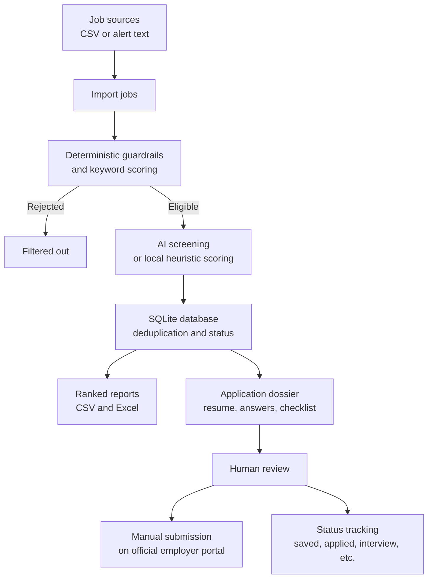

# Job Scout

Job Scout is a local, configurable, human-gated job discovery and application
preparation assistant. It imports jobs from CSV files, filters and ranks them
against a candidate profile, prepares application drafts, generates reports,
and tracks application status in SQLite.

> **Alpha release:** the package is currently available on TestPyPI for testing.
> It has not been published to production PyPI.

> **Human approval gate:** Job Scout never submits applications automatically.
> Review generated materials and submit applications yourself through the
> employer's official portal.

## Workflow



## TestPyPI installation

Install the current TestPyPI release with PowerShell:

```powershell
.\.venv\Scripts\python.exe -m pip install `
  --index-url https://test.pypi.org/simple/ `
  --extra-index-url https://pypi.org/simple/ `
  job-scout-saptami191==0.1.0
```

The distribution name is `job-scout-saptami191`; the Python import package
remains `job_scout`, and the installed CLI command remains `job-scout`.

For development from a checkout, use an editable install instead:

```powershell
py -m venv .venv
.\.venv\Scripts\python.exe -m pip install -e .
```

Optional features:

```powershell
.\.venv\Scripts\python.exe -m pip install -e ".[llm]"
.\.venv\Scripts\python.exe -m pip install -e ".[browser]"
```

## Configuration

Create local configuration files from the sanitized examples:

```powershell
Copy-Item examples\config.example.json config.json
Copy-Item examples\candidate_profile.example.json candidate_profile.json
```

Edit:

- `config.json` for target titles, required and preferred skills, location
  preferences, experience limits, and guardrail settings.
- `candidate_profile.json` for verified contact details, education, experience,
  skills, work authorization, and factual screening answers.
- `.env` (optional) for an `OPENAI_API_KEY` or `GEMINI_API_KEY` when using
  deeper LLM-based matching.

Without an API key, screening uses the local heuristic evaluation path.

## Storage and privacy

By default, the package uses the current working directory as its home:

```text
config.json
candidate_profile.json
data/jobs.db
output/
output/applications/
.env
```

Set `JOB_SCOUT_HOME` to move this complete set of paths to another directory:

```powershell
$env:JOB_SCOUT_HOME = "C:\path\to\job-scout-home"
```

The package stores the configuration file, candidate profile, database, and
generated output under that directory. Keep personal profiles, API keys,
browser sessions, private job data, and generated application materials out of
source control.

## Typical workflow

### 1. Import jobs

The CSV should contain at least `job_id`, `title`, `company`, and a URL or
description. A sanitized example is provided at
`examples\jobs.example.csv`.

```powershell
.\.venv\Scripts\python.exe -m job_scout.cli import examples\jobs.example.csv
```

Import your own file with:

```powershell
.\.venv\Scripts\python.exe -m job_scout.cli import jobs.csv
```

Import evaluates deterministic guardrails and computes the initial keyword
relevance score.

### 2. Re-run guardrails

```powershell
.\.venv\Scripts\python.exe -m job_scout.cli guardrail
```

### 3. Screen jobs

Screen the highest-ranked eligible jobs:

```powershell
.\.venv\Scripts\python.exe -m job_scout.cli ai-screen --limit 10
```

Screen one job by ID:

```powershell
.\.venv\Scripts\python.exe -m job_scout.cli ai-screen --job-id "backend-in-001"
```

### 4. Prepare an application dossier

```powershell
.\.venv\Scripts\python.exe -m job_scout.cli prep "backend-in-001"
.\.venv\Scripts\python.exe -m job_scout.cli prep-top --limit 3
```

Generated dossiers are written under `output\applications\`. They are drafts
for human review and can include a tailored resume, screening-answer draft,
and approval checklist. Subjective or unverified answers are not submitted
automatically.

### 5. Generate reports

```powershell
.\.venv\Scripts\python.exe -m job_scout.cli report --limit 30
```

This generates `output\ranked_jobs.xlsx` and `output\ranked_jobs.csv`. Include
jobs with unknown country eligibility with:

```powershell
.\.venv\Scripts\python.exe -m job_scout.cli report --limit 30 --include-unknown
```

### 6. Update application status

```powershell
.\.venv\Scripts\python.exe -m job_scout.cli status `
  "backend-in-001" applied `
  --notes "Submitted on company portal"
```

The exact status values accepted by the CLI are:

```text
saved
screened
reviewing
ready_for_review
approved_by_human
applied
interview
rejected
closed
```

### 7. Open active jobs

```powershell
.\.venv\Scripts\python.exe -m job_scout.cli open --limit 5
```

### 8. Inspect a public listing URL

```powershell
.\.venv\Scripts\python.exe -m job_scout.cli inspect-url "https://example.com/job-page"
```

URL inspection is read-only. It does not click Apply or interact with an
employer portal.

## Daily workflow

Run the complete workflow with:

```powershell
.\.venv\Scripts\python.exe -m job_scout.cli daily
```

The `daily` command uses `jobs.csv` in the configured home directory and runs
these steps in order:

1. import new listings
2. re-evaluate guardrails
3. AI-screen up to five eligible jobs
4. prepare dossiers for up to three eligible jobs
5. generate the ranked report, including unknown eligibility states

The command does not submit applications.

## Supported sources and limitations

- CSV import is supported through the `import` command.
- Alert text can be parsed through `job_scout.alerts_ingest`, but the package
  does not connect directly to email, LinkedIn, Naukri, Indeed, or Wellfound.
- Browser support is optional and intended for read-only public listing
  inspection.
- Portal status synchronization is not implemented.
- CAPTCHA bypass, authentication bypass, unauthorized scraping, and automatic
  application submission are not provided.

## Windows Task Scheduler

The repository includes `daily_job_scout.bat` and `daily_job_scout.ps1` for
optional scheduling. If you schedule the workflow, configure the task's
working directory so that `jobs.csv` and the configured home directory resolve
as expected.

## Responsible use

Source adapters and listing inspection must comply with the relevant site's
terms of service, API rules, privacy requirements, rate limits, and applicable
law. Final application submission is intentionally a human action.

## License

This project is licensed under Apache-2.0.
